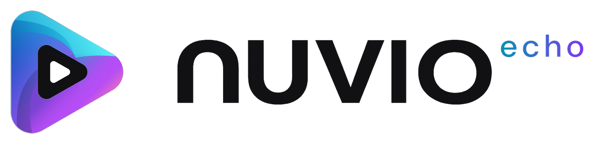

<div align="center">

  <picture>
    <source media="(prefers-color-scheme: dark)" srcset="assets/brand/echo_logo_dark.png" />
    
  </picture>

  <p>
    A fast media app for Android TV, with a glass look.
    <br />
    Bring your own addons. Nuvio Echo turns them into a library with artwork, trailers, ratings, subtitles, and your place saved.
  </p>

  

  <p></p>

  <a href="https://github.com/Laking22/Nuvio-Echo/releases/tag/beta"><b>Download the latest beta</b></a>

</div>

## Download

| Your device | File |
| --- | --- |
| Most Android TV and Google TV boxes (32-bit) | [https://github.com/Laking22/Nuvio-Echo/releases/download/v1.1.0-beta/app-full-armeabi-v7a-beta.apk) |
| 64-bit devices (NVIDIA Shield, newer Google TV devices) | (https://github.com/Laking22/Nuvio-Echo/releases/download/v1.1.0-beta/app-full-arm64-v8a-beta.apk) |
| Not sure | [https://github.com/Laking22/Nuvio-Echo/releases/download/v1.1.0-beta/app-full-universal-beta.apk) (works on any device, bigger download) |

To install, open the APK on your TV with a file manager or the Downloader app and allow installs from that app when asked. A newer APK installs over the old one and keeps your settings.

Everything that uses TMDB works out of the box. You can use your own TMDB key instead, and add a Gemini key for smarter recommendations, in **Settings → Integrations → API keys**.

## What's new

### A redesigned interface
The whole app now uses one glass look, built for a TV remote. Home has an optional edge-to-edge hero, a sidebar or a top bar, a soft glow taken from the artwork, and a card size slider in place of the old interface size setting. The details page, the player, Settings, Search and the Library were all redrawn to match.

### Quick starts
Playback starts sooner because the waiting happens earlier:
- Connections to your addon servers are opened when the app starts, and a title's sources are fetched as soon as you rest on it (Continue Watching cards and episode rows included), before you press anything.
- The chosen stream's server is warmed up while the player is still loading, and playback starts on a smaller first buffer.
- A title you were watching resumes on the link it last played, unless that link was below 720p.
- The next episode's sources are found ahead of time.

Every speed-up has its own switch under **Settings → Beta speed-ups**.

### The intro loader
A short animation of the logo (shown at the top of this page) plays while a title loads, so the wait reads as part of the show instead of a spinner. It lasts 3 to 6 seconds (your choice) and ends as soon as the video is ready.

### Audio and quality parser
Addons describe their streams in very different ways, so Echo reads every part of a source: the quality field, the resolution the addon reports, the file name and the label. A resolution stated outright ("1080p", "4K") beats a loose word ("HD", "UHD"), and when an addon gives every quality the same file name, the label's own resolution wins. Audio languages are read the same way ("ENG DUB", "Dual", "Hindi", flags), so the audio menu lists the languages available across all your sources, not only the one that's playing.

### Auto quality
Pick **Auto** in the quality menu and the quality follows your connection. Echo measures the download speed and watches for stalls, steps down early before the picture freezes, and only steps back up after a calm stretch with plenty buffered. Switching sources is seamless (the picture holds while the new one loads), and Auto never moves to a source without sound.

### Seek previews
Hold left or right on the progress bar and a thumbnail of that moment appears. It works with MP4, MKV, HLS and DASH streams, including 10-bit files, and doesn't slow down the video you're watching. Holding the key also speeds up gradually, so crossing a whole film is quick without overshooting.

### Search, redone
A new search screen with its own on-screen keyboard. Results appear as you type, suggestions show above the keyboard, and the results from all your addons are ordered by how well known each title is, so the one you meant comes first. Voice search is built in.

### Genres
A new Genres tab next to Search: browse movies, shows or anime by genre, narrow it down with keywords ("heist", "time travel"), and sort by popularity, rating or release date. It works from TMDB, or from Cinemeta when TMDB isn't available.

### Smart Highlights
Home mixes in themed rows that change every day: 30 built-in themes ("The Butler Did It", "Grab the Tissues" and more), the day's popular Trakt lists under their own names, and **Trending This Week** from Trakt. With MDBList connected, one of your own MDBList lists joins them each day, along with MDBList's top lists. The themes you're shown lean towards what you watch, save and rate; titles you've watched are left out, and no title appears in two rows. You can block or snooze any row, and a Gemini key adds an optional check of each row and AI-written names.

Alongside them are **Trending**, **Top Movies and Shows Today**, **Because You Watched** and **For You**, built from your own history and ratings.

### Grand rows
Any catalog or built-in row can be made a Grand row: hero-sized cards with the title's logo, details and trailer inside. The daily Smart Highlights use them too.

### Bins
The Library is now Bins: your own collections of titles, shown as fanned posters over a blurred mix of their artwork. Make as many as you like, star your favourites, reorder them, and add titles from a title's page or by holding OK on a poster on Home. A Cloud tab lists the files in your debrid services, ready to play.

### Collections, Calendar and the pause screen
A collection folder opens as rows or as tabs, whichever the collection is set to. Rows make it a small Home: a hero of its titles, then a row per source with the same cards that open out to the backdrop and logo when you rest on them. Tabs put each source (and an optional "All") in a tab over a poster grid, with the focused title's details beside it. The Calendar was redesigned to match the app: the focused show in a spotlight on the left, the page tinted with its colours, date tiles beside each show, and artwork in the month grid. When a video has been paused for a while, a quiet overlay shows the title, the episode, the synopsis and how much is left.

Settings that take some explaining have a small **i** button beside them that explains how they work (pre-fetching, seek preview quality, hot swap and others).

### And more
A Calendar of upcoming episodes with reminders, a details page with reviews, ratings and the cast's filmographies, release reminders for titles that aren't out yet, anime mode with Kitsu, a detailed parental guide, and a speed test.

Custom posters still work everywhere posters are shown: a poster URL set in **Settings → Layout**, and posters supplied by addons and poster managers. If a custom poster fails to load, the original appears instead. With TMDB's own artwork turned on (TMDB settings), TMDB posters take the place of both, as before.

## What's gone

These were removed in the redesign and no longer work:
- **The Classic, Grid and Modern layouts.** The new look is the only one, and with them went their own options: the collapsible and modern sidebars, the floating pill, the full-screen hero backdrop and the classic focus gradient.
- **Landscape posters** and the "always show landscape clear logo" option. Regular rows show posters, and highlighted and Grand rows show the artwork wide.
- **Interface size**, replaced by the card size slider.
- **The old Library** with its list, genre and year filters, replaced by Bins.
- **The old details page options:** the episode options overlay style, episode ratings on the details page, the full release date, and the random episode button.
- **The old focus and trailer options:** expand-on-focus and its delay, where trailers play, and the "Trailer" chips. Focused cards now always open out, and trailers play inside them and on the hero, with a single Trailer sound setting.
- **Blurring the next episode in Continue Watching,** and **choosing which player buttons sit on the main row.**
- **Automatic subtitle sync,** which was tried and taken out.
- **The "follow Home's layout" collection mode,** now the same as Rows.
- **In-app updates.** Echo doesn't update itself; new versions are on the releases page.

## Build from source

```bash
git clone https://github.com/Laking22/Nuvio-Echo.git
cd Nuvio-Echo
./gradlew :app:assembleFullBeta
```

The APKs land in `app/build/outputs/apk/full/beta/`. Nuvio Echo is built with Kotlin, Jetpack Compose, TV Material 3, and Media3; you need Android Studio (or a JDK 17+) and the Android SDK. Optional settings go in `local.properties`, with `local.example.properties` as the template.

## Security notes

Some of how Echo works comes unchanged from NuvioTV and is worth knowing:
- **Addon connections don't check HTTPS certificates,** so self-hosted addons with self-signed certificates work, and playback retries without the check if a certificate fails. On a network you don't trust, someone could read addon and stream links, which can contain debrid or other API keys.
- **CloudStream extensions run with the app's full access,** including your accounts' sign-ins. Only add repositories you trust, and only over `https://`.
- **Opening a `stremio://` or `nuvio://` link installs that addon without asking.**
- **While a "set up on your phone" page is open,** anyone on the same network can reach it. Close it when you're done.

## License

Nuvio Echo is free software under the [GNU General Public License v3.0](./LICENSE). It is a modified version of NuvioTV, also licensed under the GPL-3.0, and keeps that project's copyright notices as the license requires.

## AI disclosure

AI was used heavily in the development of this fork.
